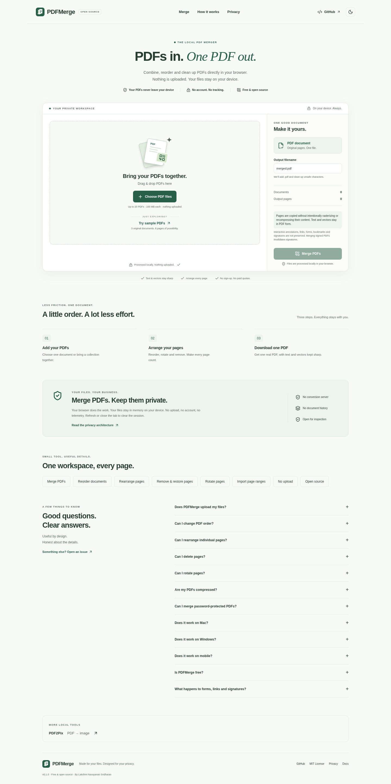

# PDFMerge

**Merge PDFs. Keep them private.**

A free, open-source PDF merger that runs entirely in your browser. Combine, reorder, rotate and remove pages without uploading your files.

**No upload. No account. No telemetry.** Version **0.1.0**.

[Repository](https://github.com/LakshmiNarayanan2003/merge-pdfs) · [GitHub Pages target](https://lakshminarayanan2003.github.io/merge-pdfs/) · [Verification record](docs/VERIFICATION.md)

The Pages URL is the configured deployment target; publication is not established by a local build.



[Dark workspace](docs/images/workspace-dark.png) · [Page editing](docs/images/page-view.png) · [Mobile](docs/images/mobile.png)

## Features

- Load one PDF or a collection via picker or drop. Add more files at any time while idle.
- Arrange entire documents by dragging or keyboard-accessible up/down buttons.
- Interleave individual pages from different documents in Page View; this is the exact export order.
- Rotate left/right in 90° steps, remove pages, undo the last page edit, restore all removed pages.
- Select all, deselect, invert, batch delete and batch rotate. Selection is for editing; all included pages are exported.
- Per-document ranges such as `3,1-2,5`, preserving listed order and deduplicating entries.
- Editable sanitized filename, verified PDF download, download again and clear session.
- Original three-document, eight-page sample through the same production pipeline.
- Lazy bounded previews, paginated 12-page editing, two concurrent thumbnails, worker-based cancellable merging.
- System-default light/dark themes and responsive touch/keyboard controls.

## Preservation and limitations

Pages are copied with **pdf-lib**, never intentionally rasterized or recompressed. Text, vector operators, raster image resources, page sizes, crop boxes and rotations are retained in our generated fixtures. Internal PDF structures are rewritten; byte-for-byte preservation is not promised.

Interactive annotations, links and form widgets are deliberately removed. Form values shown only in widgets can disappear; flatten a copy in a trusted editor first. Bookmarks, document actions, attachments and signatures are not imported. Merging a signed PDF invalidates its digital signature. Keep your originals. This tool is not a PDF sanitizer, archival conformance validator or accessibility-tag preservation tool. See [PDF support](docs/PDF_SUPPORT.md).

**Encrypted PDFs are unsupported**, including files PDF.js could unlock. pdf-lib cannot reliably decrypt them. They are rejected locally with an explanation. No password is requested and there is no server fallback.

Safeguards: **20 documents, 100 MB each, 500 MB combined, 1000 total source pages**. These are memory safeguards, not subscription limits. Decoded PDF memory may exceed input size; mobile devices may need much smaller batches. Fully offline operation is not guaranteed because static rendering assets may load on demand.

## Development

Node **24.19.0 LTS**, npm; no application environment variables or API keys.

```sh
nvm use
npm ci
npm run dev
```

Open the server's printed `/merge-pdfs/` path. Production preview: `npm run build && npm run preview`.

```sh
npm run fixtures
npm run check
npx playwright install --with-deps chromium firefox webkit
npm run check:full
```

`check` runs TypeScript, ESLint, formatting, unit/component/engine tests, production build, static/privacy checks and documentation links. `check:full` also regenerates fixtures, records coverage, runs all browser tests, generates screenshots and audits dependencies. It expects Playwright browsers/system libraries already installed. [Testing](docs/TESTING.md).

Useful scripts: `lint:fix`, `format`, `format:check`, `test:coverage`, `test:e2e`, `screenshots`, `check:assets`, `check:privacy`, `check:docs`.

## How it works and privacy

1. The File API reads local PDF bytes. PDF.js parses them using a bundled local worker and renders previews.
2. Immutable page IDs keep source identity separate from displayed positions. Edits change an in-memory page model.
3. A separate local worker uses pdf-lib to copy included pages in displayed order, adding rotation and fresh PDFMerge metadata.
4. pdf-lib reopens the output and verifies signature/page count. PDF.js checks page count and interprets the first page before success.
5. An in-memory Blob/Object URL provides the download. Edits revoke stale results; removal/clear/unmount release workers, caches and URLs.

No PDF bytes, filenames, extracted text or passwords are sent to the network or browser storage. Static hosting still sees ordinary website requests. The sample button downloads public bundled samples; user files never use this fetch path. Browser extensions, operating-system swap and downloaded files are outside application control. JavaScript cannot securely erase all memory. [Privacy](PRIVACY.md) · [Security](SECURITY.md) · [Architecture](docs/ARCHITECTURE.md).

## Browser support and accessibility

Targets current Chromium, Firefox and WebKit/Safari with module workers, ES2022, File/Blob, canvas and modern PDF.js requirements. Automated engine results, axe results and environmental restrictions are recorded in [verification](docs/VERIFICATION.md), without inferring unrun tests pass. Semantic controls, visible focus, skip link, status announcements, non-drag reorder alternatives and reduced-motion support are included. Automated axe is not formal WCAG certification. Manual screen-reader and real iOS download behavior remain useful release checks.

## Deployment

GitHub Actions CI installs the lockfile, runs deterministic checks, browser/privacy/axe tests, screenshots, coverage and audit. Pages deployment waits for CI and publishes its exact verified artifact on `master`; PRs do not deploy. Configure GitHub Pages to use **GitHub Actions**. Default Vite base is **`/merge-pdfs/`**; `VITE_BASE_PATH` supports alternate static subpaths. No custom domain is configured. [Deployment guide](docs/DEPLOYMENT.md).

## Project

Sibling of [PDF2Pix](https://lakshminarayanan2003.github.io/pdf-to-image/). Its owner-authored design/configuration patterns were adapted with PDF-specific conversion code replaced by merging logic. No verified Pix2PDF checkout or URL was available, so no link is invented.

[Changelog](CHANGELOG.md) · [Roadmap](ROADMAP.md) · [Decisions](docs/DECISIONS.md) · [Contributing](CONTRIBUTING.md) · [Third-party notices](THIRD_PARTY_NOTICES.md)

MIT © 2026 **Lakshmi Narayanan Sridharan**. [License](LICENSE).
