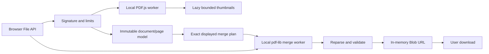

# Architecture

React/strict TypeScript/Vite provide a static frontend. Lucide icons and system fonts are bundled/local. CSS shares PDF2Pix's restrained design tokens without requiring a utility CSS runtime. There is no backend, database, account or application-level IPC. Web Workers use browser postMessage for local concurrency only; no native process IPC is involved.

## Source and page models

A SourceDocument owns an immutable UUID, original File object, PDF.js document proxy and bounded Blob thumbnail cache. Original bytes are not persisted. PDF.js owns a transferred read buffer; merging reads File bytes in its own worker. These stages need independent working memory, documented rather than claimed zero-copy.

Each PageItem has a UUID independent of array index, documentId, zero-based sourcePageIndex, additional normalized rotation, selected and removed flags. The array is the sole output-order authority. `mergePlan` filters removed pages and validates identities/counts/indices/rotations. Checkboxes select editing targets; unchecked included pages still export. Original page rotation is added to the edit rotation at copy time and preview time.

Document reordering deliberately groups each document's pages while keeping their current within-document order. Page View can subsequently interleave freely. Range import respects entered sequence and first occurrence, regroups that document at its first position and retains excluded pages as removed entries. Empty range restores all in source order. One previous page-array snapshot supports undo; document removal/addition clears undo to avoid references to destroyed sources. Restore-all reactivates removed entries at their retained model positions.

## Rendering and resources

PDF.js receives data bytes and local auxiliary paths with XFA disabled, no viewer scripting/annotation layer. Thumbnails render only near the viewport, at no more than 220 pixels per dimension, with two concurrent render slots. Only 12 page cards are mounted at a time; document view has at most 20 lazy first-page previews. Each source cache retains at most 12 compressed thumbnail Blobs. Canvases reset after encoding, render tasks cancel on unmount, and component-owned preview URLs are revoked. Cache references clear with document disposal; PDF.js loading tasks/workers are destroyed.

Merge runs off the main thread. The worker loads required sources with pdf-lib, removes page Annots/AA/A entries, copies pages individually in the displayed plan, sets total rotations and fresh metadata, saves and reparses the result. Text/vector/image page content is copied instead of painted into replacement images. New catalog creation avoids importing source document actions/outlines/attachments. This is a deliberate feature subset, not a universal sanitizer.

Progress messages describe real copied pages. Cancel immediately terminates a running merge worker, including serialization work. Main-thread file reads/PDF.js validation are asynchronous but may finish before cancellation is observed; no cancelled result is presented. Output validation uses pdf-lib plus PDF.js page count/first operator list. It does not render every output page or prove every possible reader accepts it.

Blob download URLs live until the next edit/filename change/new operation/clear/unmount. Source File references and PDF.js documents are released on removal. Downloaded files and OS/browser memory behavior are outside this lifecycle.

## Safety limits

20 files, 100 MB/file, 500 MB combined, 1000 source pages, 12 displayed page cards, 220-pixel thumbnails, two render slots. Source-page limits include removed pages because sources still occupy memory. These conservative caps are product safeguards, not browser guarantees: decoded images/fonts and pdf-lib object copies can be much larger than compressed input. No streaming output is claimed.

[Decisions](DECISIONS.md) · [Privacy boundary](../PRIVACY.md) · [PDF feature behavior](PDF_SUPPORT.md).
